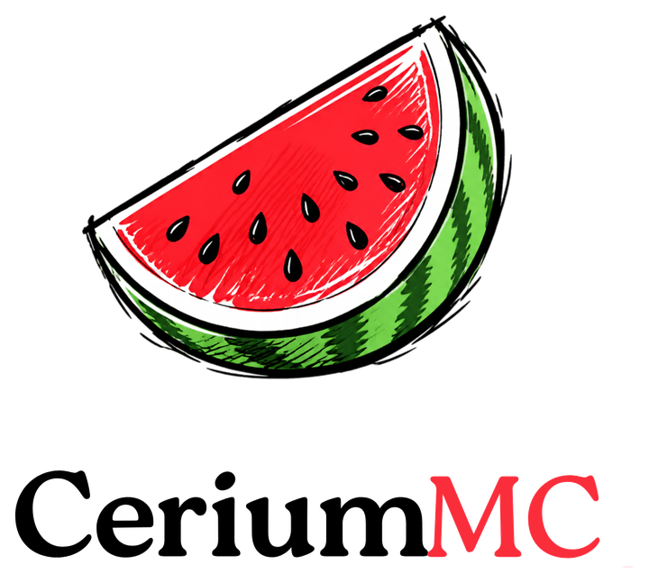
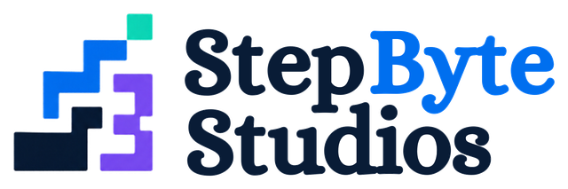

<div align="center">

<picture>
  <source media="(prefers-color-scheme: dark)" srcset="docs/assets/ceriummc-logo-dark.png">
  
</picture>

### A Minecraft: Java Edition server, rewritten from scratch in idiomatic Rust.

[](LICENSE)
[-62b47a.svg)](#target-version)
[](ROADMAP.md)
[](#ai-disclaimer)

</div>

---

> [!IMPORTANT]
> ## AI disclaimer
>
> **CeriumMC is an AI-coded project.** Its code, documentation and tooling are written mostly by
> AI under human direction and review. The project exists **for research and the public good**:
> to explore how far AI-assisted engineering can go on a large, exacting systems project.
>
> - Expect bugs, because the code has not been battle-tested.
> - Every change is reviewed by a human maintainer and must pass GitHub CI before it lands.
> - The git history is authored by the maintainer. AI tools are credited here rather than as commit co-authors.

---

## What is CeriumMC?

CeriumMC is a ground-up Rust rewrite of the vanilla Minecraft: Java Edition dedicated server.
The project studies how the official server behaves and re-implements that behaviour as
**idiomatic Rust**, rather than as a line-by-line port of Java.

The goal is a server that a vanilla client cannot tell apart from the official one, but that
boots in milliseconds, runs lean on memory, uses every CPU core it safely can, and runs on
anything from a Raspberry Pi or an Android phone to a dedicated machine.

## Milestones

| | Milestone | In one line |
|---|---|---|
| **Q1** | [Vanilla parity](docs/goals/Q1-vanilla-parity.md) | 100% identical behaviour to vanilla: protocol, world generation, tick mechanics, data and config |
| **Q2** | [`.HCR` region format](docs/goals/Q2-hcr-format.md) | A crash-safe, Hybrid-MP4-style chunk format; 50–70% smaller and 4–5× faster than `.mca` |
| **Q3** | [Plugins API](docs/goals/Q3-plugins-api.md) | A first-class, stable API for extending the server |
| **Q4** | [CeriumMC plugin library](docs/goals/Q4-plugin-library.md) | Official plugins built on that API |
| **Q5** | [Pooled multi-machine server](docs/goals/Q5-pooled-server.md) | One world running on friends' pooled home PCs, with seamless failover |

Q1 is built in 15 phases; see **[ROADMAP.md](ROADMAP.md)**.

## Design principles

- **Parity first.** When speed and exact vanilla behaviour conflict, parity wins. Work runs in
  parallel only when it is proven to be order-independent, so tick results stay deterministic.
- **Idiomatic, not translated.** The architecture is original Rust. Vanilla's algorithm structure
  is followed closely only where bit-exact output requires it, such as world generation and RNG.
- **Lean by default.** Targets are ≤1 GB RAM for 20–30 players and near-instant boot, on existing
  and fresh worlds alike.
- **Runs anywhere.** Targets are x86_64 Linux, Windows, ARM boards (Raspberry Pi and ARM cloud),
  and Android.

## Target version

| | |
|---|---|
| Minecraft | **26.3** (Java Edition) |
| Protocol | 777 |
| World version | 5023 |
| Data pack format | 121.0 |

CeriumMC stays pinned to 26.3 until Q1 parity is reached, then moves to the latest release.

## Building

CeriumMC is a Cargo workspace pinned to Rust **1.99.1** (`rust-toolchain.toml`, edition 2024):

| Path | What it is |
|---|---|
| `crates/ceriummc` | The server binary. For now it only reports its version. |
| `crates/cerium-version` | The single source of truth for the targeted vanilla release. |
| `tools/cerium-probe` | Status-ping client and boot benchmark harness, used against vanilla and CeriumMC alike. |

```sh
cargo build --release
cargo test --workspace
```

All builds, tests and benchmarks run in **GitHub Actions**:

- Linux x86_64 and AArch64, Windows and macOS are built and tested natively.
- ARMv7 (Raspberry Pi) is cross-built and tested under QEMU.
- Android (AArch64 and ARMv7) is cross-built.
- In a separate job, the official vanilla 26.3 server boots in CI as the parity reference. Its
  boot time and memory use are measured by the same probe that will measure CeriumMC.

## Contributing

Contributions are welcome. Please read [CONTRIBUTING.md](CONTRIBUTING.md) and the
[Code of Conduct](CODE_OF_CONDUCT.md) first, and report vulnerabilities privately as described
in [SECURITY.md](SECURITY.md).

## Legal

- CeriumMC is **not** an official Minecraft product. It is not approved by or associated with
  Mojang or Microsoft. "Minecraft" is a trademark of Mojang Synergies AB.
- This repository contains **no Mojang code or game assets**. The official server is studied
  locally for research only, and nothing derived from it is committed or distributed. See
  [docs/LEGAL.md](docs/LEGAL.md).
- Players connect with their own legitimately purchased Minecraft: Java Edition clients.

## License

CeriumMC is licensed under the **GNU General Public License v3.0**. See [LICENSE](LICENSE).

---

<div align="center">

<a href="https://github.com/ashfaqizop">
  <picture>
    <source media="(prefers-color-scheme: dark)" srcset="docs/assets/stepbyte-studios-logo-dark.png">
    
  </picture>
</a>

CeriumMC is a **StepByte Studios** project.

</div>
